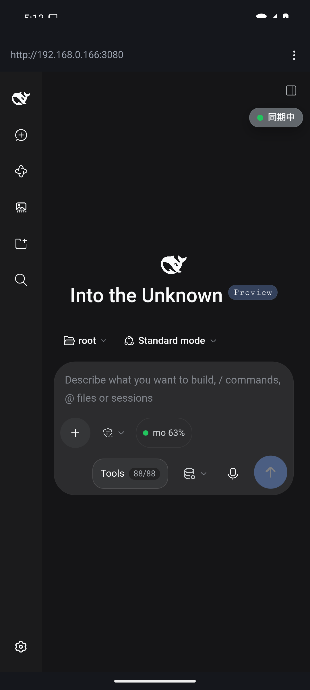

# DSH Mobile — PC と自動同期するスマホ版 DSH

DeepSeek Harness（DSH）を **スマホからも使えるように**するプラグインです。
PC と同じ **1 つの Host** にスマホから接続するので、会話・セッションは
「同期する」のではなく **最初から同じもの** を共有しています。

```
  PC のブラウザ ──┐
                  ├──  1 つの DSH Host ── セッションストア（$DSH_HOME/sessions）
  スマホ ─────────┘        （WebSocket のライブイベントストリーム）
```

- ホスト側: `index.js`（ペアリング、PWA の配信、接続状態の注入）
- ブラウザ側: `client.js`（スマホ用レイアウト、同期チップ、未送信キュー、PWA 化）

---

## 1. 「自動同期」が成立する理由

DSH のセッションは **単一書き込みの追記ログ** で、プロセス間の排他ロック
（Windows では名前付きセマフォ）があります。したがって「PC 側とスマホ側で
セッションをコピーして同期する」方式は原理的に成立しません（先ほどの
`dsh-profile-sync` も、設定だけは同期し、セッション履歴は対象外として
います）。

本プラグインはこれを回避します。**スマホは Host のもう一つのクライアント**です。

- セッションの書き込みは **Host だけ** が行う（ロック競合は起きない）
- PC とスマホは同じイベントストリームを購読するので、**片方で起きたことは
  もう片方に即座に反映される**（スクロール位置・生成中表示も含む）
- スマホが PC に到達できない時間帯のメッセージは、**未送信キュー**に
  貯めて、回線が戻った瞬間に自動送信する

つまり「同期」はコピー処理ではなく、**構造上の帰結**です。

## 2. 導入

プラグインは `@local/dsh-mobile` というローカルパッケージとして、
DSH プロファイルに読み込みます。`web` プロファイルには導入済みです。

```jsonc
// C:\Users\tatud\.dsh\profiles\web\package.json
{
  "dependencies": {
    "@local/dsh-mobile": "link:C:/root/dsh-mobile"
  },
  "dsh": {
    "profile": {
      "bundles": ["…", "@local/dsh-mobile"]
    }
  }
}
```

パッケージの実体（本プラグイン）は `C:\root\dsh-mobile` にあります。

## 3. 使い方

### 3.1 PC 側でホストを起動する

```powershell
C:\root\dsh-mobile\dsh-mobile.ps1 start
```

- ホストを **LAN の IPv4:3080**（LAN 公開）で起動します
- 起動後に **ペアリングカード**（PIN・URL・QR）が端末に出力されます
- カードと引き換え用のファイルは `C:\Users\tatud\.dsh\mobile-pair.json` に
  書き出されます（`DSH_HOME` 配下。トークンを含むため他人に見せないこと）

```
dsh-mobile: phone pairing ready
dsh-mobile:   PIN   144422
dsh-mobile:   URL   http://192.168.0.166:3080/?token=…
dsh-mobile:   PIN page http://192.168.0.166:3080/mobile
```

補助コマンド:

```powershell
.\dsh-mobile.ps1 status    # 起動状況とペアリングカード
.\dsh-mobile.ps1 stop      # 停止
.\dsh-mobile.ps1 restart   # 再起動（PIN とトークンが更新されます）
```

`dsh web` を直接起動する場合も、LAN 公開のためにはパッチ層が必要です。

```powershell
dsh --profile web --patch C:\root\dsh-mobile\lan.patch.yml --no-open
```

> dsh 0.2.1 以降、`0.0.0.0`（ワイルドカード）への bind は
> **webserver プラグインが起動時に拒否**します（理由も同上: ネットワークに
> RCE を公開するため）。そのため `lan.patch.yml` では `host` に
> **具体的な LAN の IPv4 アドレス**を入れます。
> `dsh-mobile.ps1 start` は既定経路を持つ NIC の IPv4 を自動検出して
> `DSH_MOBILE_BIND` に渡すので、DHCP で IP が変わっても起動し直せば済みます。
> なお CLI とデスクトップアプリの dsh の**バージョンが違うと**、
> セッションログのイベント型を解釈できず「履歴の読み込みに失敗」になります
> （§3.1.1）。

### 3.1.1 CLI とデスクトップアプリ dsh のバージョン一致（必須）

スマホ/Web 側のホスト（`dsh web`）と、デスクトップアプリとで **dsh のバージョンが
違うと**、デスクトップアプリが書いたセッションログを Web 側が読めません。
Web 側は新しい型のイベント（例: `job/registered`）を解釈できないまま
「そのログは新しい harness が書いた可能性が高い」と判断し、**履歴の読み込みを
拒否**します。チャット画面には次のようなエラーが出ます。

```
履歴の読み込みに失敗しました: failed to observe session "session-...":
session "session-..." contains event type "job/registered" (seq 20) unknown to
this harness and not marked ignorable; refusing to interpret the log
（gateway/internal）
```

**対処: CLI をデスクトップアプリと同じ版に更新します。**

```powershell
npm install -g @deepseek-ai/dsh@<デスクトップアプリと同じバージョン>
dsh --version   # デスクトップアプリの version と一致していることを確認
```

デスクトップアプリの dsh バージョンは、アプリの同梱パッケージから確認できます
（`resources/app.asar\dsh\package.json` の `version`）。
`dsh-mobile.ps1 start` は起動時に CLI とデスクトップアプリの版を突き合わせ、
違う場合は警告を表示します。

### 3.2 スマホをペアリングする

1. スマホと PC を **同じ Wi-Fi** に接続する
2. スマホで `http://192.168.0.166:3080/mobile` を開く
   （ペアリングページ。PIN を求める画面が出ます）
3. PC に出ている **6 桁の PIN** を入力する
4. そのまま DSH が開き、同期チップが「同期中」になると完了です

PIN を間違えると 5 回で 10 分ロックされます（接続元アドレス単位）。

なお、**PC 側**で `http://192.168.0.166:3080/mobile` を開くと、
セッション cookie を持っているため PIN を要求されず、**QR 付きのペアリング
カード**が直接表示されます。QR をスマホで読ませても同上です。

### 3.3 起動時に PC の会話へ自動追従する

ホストは起動のたびに自分の空（blank）セッションを復元するため、スマホアプリを開いた
直後だけ「履歴のない会話」（未初期状態のセッション）が表示されます。プラグインは
起動直後にセッション一覧を取得し、**PC 側で最後に更新された会話（blank でない
最新のセッション）へ自動で移動**します。

- 対象は `updatedAt` が最も新しい、**入力済みの**セッションです。
- すでに blank でないセッションを開いている場合（ユーザーがスマホ側で入力を
  始めた場合など）は移動しません。
- ホスト再起動でトークン（ペアリング情報）が変わるため、**再起動後はスマホ側の
  再ペアリングが必要**です（§3.2）。

## 4. スマホ側の機能

| 機能 | 説明 |
| --- | --- |
| スマホレイアウト | セッション一覧は画面上のドロワーに化し、本文を圧迫しません。タッチ領域は 44px 確保、入力欄は 16px（iOS の自動ズームを防ぐ）、ノッチとホームインジケータ領域を避けます。 |
| 同期チップ | 画面右上に **同期中 / 接続中… / オフライン** を表示。タップで再接続、未送信のメッセージが残っていれば「今すぐ送信」。 |
| 未送信キュー（アウトボックス） | オフライン中に送ろうとしたメッセージは失われず、回線復帰後に**自動で送信**されます。送信前の 1.5 秒間は入力中の割り込みを避けます。 |
| PC との自動追従 | 起動直後にホストの空セッションが開いても、**PC でいま話している最新の会話へ自動で移動**します。空セッションのままだと「履歴がない」ように見えるための処理です。スマホ側で入力を始めたセッション（blank でないもの）はそのまま維持します。 |
| PWA | サービスワーカー（`/sw.js`）でアプリシェルをオフライン保持。iOS は「共有 → ホーム画面に追加」でアプリ化できます。 |
| オフライン表示 | 完全に到達不能なときは `offline.html`（再試行ボタン付き）が表示されます。 |

## 5. セキュリティ（重要）

**このホストは PC と同じ権限で、シェルやファイル操作を実行できます。**
LAN に公開する以上、認証は最後の防御線です。以下の点を確認してください。

- **認証**: 起動トークン（`/?token=…`）→ 署名済み cookie（既定 30 日）に
  交換されます。cookie を持つリクエストだけが Host の API を呼べます。
- **Origin / Host 検査**: Host は loopback と LAN アドレスの `Host` ヘッダと
  同一オリジンの `Origin` のみを受け付けます。`sec-fetch-site: cross-site` は
  拒否されます。
- **ペアリング PIN**: 未認証のクライアントが URL を取得するには PIN が
  必要（5 回失敗でロック）。
- **平文 HTTP**: このビルドは TLS を持たないため、LAN 上のトークンと
  cookie は **平文** で流れます。信頼できる Wi-Fi でのみ使うか、
  `tailscale serve` などで HTTPS を前段に置いてください。
- **公開の判断**: LAN のアドレスへのバインドは **意図的な信頼の決定** です。
  自宅や自宅内 LAN 以外では使わないでください。公開が必要な場合は
  `-Bind 127.0.0.1` にして、Tailscale など安全な経路だけを公開してください。
  （dsh 0.2.1 以降、`0.0.0.0` へのワイルドカード bind は webserver が拒否します）
- `mobile-pair.json` は**トークンを含む**ため、`$DSH_HOME` 内の他ファイル
  と同じ扱いで保管してください（POSIX では 0600 で書き込みます）。

## 6. 設定（行設定）

`cordis.patch.yml` の `dsh-mobile` 行で設定できます。

| キー | 既定 | 説明 |
| --- | --- | --- |
| `pin` | `''` | ペアリング PIN。空なら起動ごとにランダムな 6 桁 |
| `pairPath` | `/mobile` | ペアリング面の URL 接頭辞 |
| `lanUrls` | `[]` | 追加で広告するホスト |
| `maxFailedPinAttempts` | `5` | ロックまでの失敗回数 |
| `lockoutMinutes` | `10` | ロック時間（分） |

```yaml
- insert:
    - id: dsh-mobile
      name: '@local/dsh-mobile'
      config:
        pairPath: '/mobile'
        maxFailedPinAttempts: 5
        lockoutMinutes: 10
```

## 7. ファイル構成

```
C:\root\dsh-mobile\
  index.js              ホスト半: ペアリング/PWA ルート、ペアリングカード、index 注入
  client.js             ブラウザ半: スマホ CSS、同期チップ、アウトボックス、PWA
  lib/host.js           ホスト半の純関数（オプション解決、アドレス選定、QR 描画）
  assets/pages.js       ペアリングページ、オフライン頁、サービスワーカー、manifest
  assets/icon.svg       アイコン（PNG 3 種は SVG から生成済み）
  vendor/qrcode.js      qrcode-generator 2.0.4（MIT, Kazuhiko Arase）
  cordis.patch.yml      束への行挿入
  lan.patch.yml         webserver 行を LAN の IPv4 に差し替えるオーバーレイ
  tools/                診断ツール（履歴/セッション追跡、APK 解析、UI 操作）
  dsh-mobile.ps1        起動・停止・状態表示
  android/              ネイティブ Android アプリ（WebView シェル）
  docs/phone.png        Android 端末で動かしたときの画面
  test/                 node:test による単体・結合テスト
  tools/                実機 Chrome を操作する検証スクリプト（下記）
```

## 8. 検証

### 自動テスト

```powershell
node --test                              # 単体テストのみ
$env:DSH_MOBILE_TEST_URL = "http://127.0.0.1:3080"
node --test                              # 起動中ホストに対する結合テストも走る
```

### 実機相当の検証

`tools/` は実物の Chrome を DevTools プロトコルで操作し、スマホビューポート
（390×844）で挙動を確かめるものです。

```powershell
node tools\verify.mjs      "http://192.168.0.166:3080/?token=…"   # レイアウト/チップ/SW
node tools\outbox-probe.mjs "http://192.168.0.166:3080/?token=…"  # オフライン→自動送信
node tools\ui-probe.mjs    "http://127.0.0.1:3080/?token=…" "http://192.168.0.166:3080/mobile"
node tools\pair-probe.mjs  "http://192.168.0.166:3080/?token=…" "http://192.168.0.166:3080/mobile"
node tools\composer-probe.mjs "http://192.168.0.166:3080/?token=…"  # 入力欄の編集可否
node tools\history-probe.mjs "http://192.168.0.166:3080"             # セッション一覧/履歴の読み込み
node tools\follow-probe.mjs "<sessionId>" "http://192.168.0.166:3080" # 特定セッションのスナップショット
node tools\webview-log.mjs 20                                    # スマホ WebView のコンソール/例外
node tools\webview-source.mjs "__DSH_MOBILE_MIRROR__"            # 実際に読み込まれた JS の中身
node tools\asar-list.mjs "@deepseek-ai/dsh-client"                # asar 内のファイル一覧
```

`tools\ui.ps1` は Android エミュレータの画面を操作します（`tap` / `type` / `dump`）。

```powershell
pwsh -NoProfile -File tools\ui.ps1 tap "接続する"
pwsh -NoProfile -File tools\ui.ps1 type "180585"
pwsh -NoProfile -File tools\ui.ps1 dump
```

実測結果（スマホビューポート）:

- ビューポート: `width=device-width, initial-scale=1, viewport-fit=cover`
- 同期チップ: `同期中`（切断時 `オフライン`）
- 枠: `56px 334px 0px`（レールを残し、本文は全幅。開いたパネルは `position:absolute` で重畳）
- 入力欄: `16px`、送信ボタン `44×44`、横スクロールなし
- アウトボックス: オフライン送信 → `未送信1件`、回線復帰 → 自動送信され本文に反映

## 9. Android アプリ（.apk）

`android/` には、同じ DSH ホストをスマホから使うための **ネイティブ Android
アプリ**があります。ブラウザ版と同じ Web UI を WebView で表示するだけで、
dependency はゼロ（APK 約 29 KB）です。



- 初回起動時に **接続先**（例 `192.168.0.166:3080`）を入力
- そのまま **ペアリングページ**が開くので、PC に出ている PIN を入力
- 以降は cookie だけで自動接続（トークンなしでホストのルートを開く）
- 同期状態はメニューから確認でき、未送信メッセージは画面内で確認できる
- ファイル選択・マイク（音声入力）に対応

### 動作確認

Android エミュレーター（API 35, x86_64）で実際に apk を起動して確認しました。

1. 接続先を入力して「接続する」→ PC の **ペアリングページ** が WebView に開く
2. PC に出ている 6 桁の PIN を入力 → 起動 URL が表示され「DSH を開く」で本体へ
3. 本体が開き、**PC と同じセッション**（`Into the Unknown`）が一覧に出る
4. アプリを強制終了して開き直しても、**トークンなしでルートへ直行**して
   再接続する（cookie が Android の WebView に残るため）

WebView の中の実際の状態は DevTools プロトコルで読み取れます。

```powershell
node tools\webview-cdp.mjs "JSON.stringify(window.__DSH_MOBILE_STATE__())"
# => {"state":"connected","pending":0}
```

### ビルド

```powershell
$env:JAVA_HOME = "C:\Program Files\Java\jdk-17"
cd C:\root\dsh-mobile\android
gradle assembleRelease      # 署名済みの release APK
gradle assembleDebug        # debug APK
```

出力は `android\app\build\outputs\apk\release\app-release.apk` です。

### 署名

リリースビルドは **リポジトリに含めない keystore** で署名します
（`android/dsh-mobile.keystore`、`.gitignore` 済み）。keystore が無い場合は
debug キーで署名されるため、そのまま端末へサイドロードできます。

```powershell
keytool -genkeypair -v -keystore android\dsh-mobile.keystore `
  -alias dsh-mobile -keyalg RSA -keysize 2048 -validity 10000
```

このプロジェクトで使っている keystore のパスワードは `dsh-mobile` です
（alias も同じ）。**keystore ファイルはリポジトリに含めていません**。
別の keystore を使う場合は `DSH_MOBILE_KEYSTORE_PASSWORD` /
`DSH_MOBILE_KEY_ALIAS` / `DSH_MOBILE_KEY_PASSWORD` を環境変数で渡します。

署名を更新するときは、同じキーで署名しなおさないと、既存のインストールは
更新できません（別キーになると再インストールが必要になります）。

### 端末へインストール

```powershell
adb install -r android\app\build\outputs\apk\release\app-release.apk
```

GitHub のリリースに APK を添付してあるので、スマホのブラウザから
ダウンロードして直接インストールすることもできます（設定で「不明なソース」を
許可）。

## 10. 既知の制限

- **CLI の dsh はデスクトップアプリと同じバージョンにしてください。**
  違うとセッションログのイベント型を解釈できず「履歴の読み込みに失敗」
  になります（§3.1.1）。`dsh-mobile.ps1 start` が警告を表示します。
- **平文 HTTP ではサービスワーカーが使えません**（secure context 必須）。
  オフラインシェルは `https://` または `localhost` でのみ有効です。
  iOS の「ホーム画面に追加」自体は HTTP でも可能です。
- デスクトップアプリ（Electron）は `127.0.0.1` 固定で、起動トークンがログに
  出ないため、そのまま LAN 公開はできません。**このプラグインは共有 Web
  ホスト**を前提にしています（デスクトップアプリと Web ホストは同時に
  動かせますが、同じセッションへ 2 つのホストが書き込むのは避けてください）。
- 同じセッションを PC とスマホで同時に開いて編集すると、Last-Write-Wins に
  なる可能性があります。
- ホストを再起動するとペアリングのトークンが変わるため、**スマホは再ペアリングが
  必要**です。
