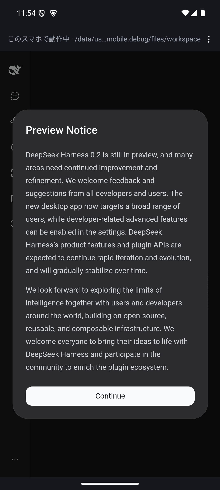

# DSH Mobile — スマホ単体で動く DeepSeek Harness

DeepSeek Harness（DSH）を **スマホの中だけで** 動かすためのアプリです。
PC は要りません。スマホの中の Node が DSH の Host になり、同じ DSH の
Web UI をアプリ内の WebView で開きます。

```
  ┌──────────── スマホ ────────────┐
  │  DSH Mobile (APK)              │
  │   ├ HostService  … node を起動  │
  │   ├ Node + DSH   … 127.0.0.1   │ ← 会話・設定はこの端末の中
  │   ├ WebView      … その UI     │
  │   └ スマホ操作ブリッジ          │ ← 画面・タップ・入力・アプリ起動
  └────────────────────────────────┘
```

- **単体モード（既定）**: スマホが Host。PC もペアリングも不要。
- **リモートモード**: これまで通り PC の Host に接続する使い方も残しています。

単体モードでは、エージェントは **このスマホの画面を見て、タップ・スワイプ・
文字入力・アプリ起動ができます**（Smartphone use）。ファイルツールは
`/sdcard/DSH` を作業場所として、スマホの実ファイルを読み書きします。

---

## 1. 仕組み

### 1.1 なぜスマホで Node が動くのか

Android には公式の Node.js バイナリがありません。このプロジェクトは
**Termux が配布している aarch64/x86_64 の Node と共有ライブラリ**を
ランタイムとして同梱し、アプリの内部ストレージで動かします。

| 部品 | 中身 |
| --- | --- |
| `bin/node` | ロックに記録した Termux の Node（`--expose-internals` 付きで起動） |
| `lib/*.so` | Node がリンクする ICU / OpenSSL / zlib など |
| `app/` | DSH のパッケージツリー（デスクトップ版と同じもの） |
| `plugins/` | スマホ操作用の DSH プラグイン |
| `profile/` | 単体モード用の DSH プロファイル |

**重要な制約**: Android 10 以降、アプリは *自分のデータ領域に置いた
バイナリを実行できません*（`fork/exec` が EACCES で拒否されます）。
そこで実行ファイルと共有ライブラリは APK の `jniLibs`（`lib*.so`）として
同梱し、インストール時に本来の名前（`bin/node`, `lib/libicuuc.so.78` など）の
**シンボリックリンク**を張ります。リンク先はアプリのネイティブ
ライブラリディレクトリなので、実行も読み込みも許可されます。

APK を更新するとネイティブライブラリのディレクトリ名が変わるため、
同じランタイムのままならリンクだけを貼り直します。対応ランタイムのハッシュが
変わった場合は、新版を検証・取得してから置き換えます。

### 1.2 DSH のブートを成立させているもの

DSH は起動時に Node の内部モジュール（`internal/modules/esm/...`）へ
到達してローダーを差し替えます。上流はそのためにネイティブアドオン
（`node-addon-require-builtin`）を使いますが、**Android 向けのビルドは
配布されていません**。

このリポジトリは `runtime/shim/require-builtin` に **JS の代替実装**を
置き、`--expose-internals` で起動することで同じことをします。ローダーが
要求するバインディング情報（product/backend/abi）を満たすので、DSH 側は
無改造のまま動きます。

### 1.3 単体モードのプロファイル

`runtime/profile/cordis.patch.yml` が `dsh-base` + `dsh-web-app` の上に
次だけを足します。

- Web サーバーを `127.0.0.1` に固定
- `smartphone-use` プラグインを挿入
- `mobile-shell`（Web UI をスマホ用にするクライアントプラグイン）を挿入

`mobile-shell` の行が要る理由: Harness は **Loader の行が読み込んだパッケージ**の
`dsh.client` を見て初めてクライアントバンドルをブラウザへ配信します。単に
`node_modules` に置いただけでは読まれません。この行と `client.js` の同梱が無いと、
単体モードはデスクトップ UI がそのまま縮小表示されます（v1.2.0 で修正）。

`{{port}}` `{{pluginsDir}}` `{{bridgePath}}` はアプリがインストール時に
実パスへ置換します（プロファイルの `name` は式を取れないため）。

### 1.4 スマホ操作（Smartphone use）

Host はアプリのサンドボックス内の Node なので、スクリーンショットや
ジェスチャーは自分では実行できません。アプリが **127.0.0.1 のループバック
HTTP ブリッジ**を立て、DSH プラグインがそれを叩きます。

```
  DSH (node) ── HTTP + Bearer token ──► PhoneBridge ──► AccessibilityService
                                          127.0.0.1        （画面・入力）
```

- トークンは起動ごとにランダム生成し、`$DSH_HOME/bridge.json` に書きます
  （アプリと Host は同じ uid なので、他のアプリからは読めません）
- ブリッジは外部公開しません（ループバックのみ）

提供するツール:

| ツール | 説明 |
| --- | --- |
| `phone_status` | 画面サイズ、ユーザー補助の有効/無効、Android の版 |
| `phone_screen` | 画面を PNG で保存（`read_image` で見る） |
| `phone_nodes` | ユーザー補助ツリー（座標つき）をテキストで取得 |
| `phone_tap` / `phone_swipe` | タップ・スワイプ |
| `phone_type` | フォーカス中の入力欄へ文字入力 |
| `phone_key` | back / home / recents / enter / delete / notification / quick_settings / lock |
| `phone_apps` / `phone_launch` | 起動可能アプリの一覧と起動 |

### 1.5 ファイルアクセス

作業場所（エージェントの `cwd`、ファイルツールの起点）は次の順で決まります。

1. **全ファイルアクセス**が許可されていれば `/sdcard/DSH`
2. そうでなければアプリ専用領域（`files/workspace`）

`README` の「権限」から「ファイルアクセス」を開いて許可すると、次の起動から
スマホの共有ストレージが作業場所になります。

---

## 2. 導入

### 2.1 APK を入れる

[リリース](https://github.com/tatudrag0n/dsh-mobile/releases) の
`app-release.apk` を端末で開き、「不明なソース」を許可してインストールします
（Android 7 以降）。

初回起動時に **ランタイム（Node + DSH、約 130 MB）をダウンロード**します。
ダウンロード先は `assets/runtime-manifest.json` に ABI ごとに書かれており、
SHA-256 で検証してから展開します。展開後はオフラインでも起動できます。

### 2.2 初回の流れ

1. アプリを開く（既定は単体モード）
2. 「ランタイムを準備しています」→「Host を起動しています」→ DSH の UI
3. 設定 → Models で API キー（または DeepSeek アカウント）を設定
   - **アカウントログインは単体モード専用**です。リモートモード（PC の Host に接続）
     では PC 側で設定してください。理由と切り分けは
     [`docs/troubleshooting.md`](docs/troubleshooting.md) に書いてあります。
   - キーは端末の `files/home/.credentials.yaml` にだけ保存されます。PC のキーは
     引き継がれません。
4. メニュー →「スマホ操作を有効にする」→ ユーザー補助を ON
5. メニュー →「権限」→ ファイルアクセスを許可（任意）

### 2.2.1 うまくいかないとき

「ログインできない」「API キーが違うと言われる」「ホストの認証が失効しました」は
原因が別々です。切り分けは [`docs/troubleshooting.md`](docs/troubleshooting.md) に
まとめました。要点だけ:

- ログインは **単体モードのみ**（リモートは PC 側で設定）。認可の待ち時間は 10 分。
- 「API key is invalid」は **キーはあるが提供元に拒否された**（401/403）という意味。
  入力の自動大文字化・前後の空白・`/sdcard/DSH/.env` の古いキーが典型原因。

### 2.3 メニュー

| 項目 | 内容 |
| --- | --- |
| このスマホで動かす（単体モード） | スマホを Host にする |
| PC のホストに接続する（リモート） | 従来のクライアント動作 |
| 権限 | ファイルアクセス・スマホ操作の状態と設定への導線 |
| スマホ操作を有効にする | ユーザー補助の設定を開く |
| 状態 | モード・Host・作業フォルダ・ランタイム版 |
| Host を再起動 | プロセスを立て直す（作業フォルダ変更の反映にも使う） |
| ランタイムを削除 | 次回起動で取り直す（会話と設定は残る） |

---

## 3. ビルド

完全な手順は **[開発・検証・リリース手順](docs/development.md)** を参照してください。
Node.js 22 以上、JDK 17、Android SDK 35 が必要です。ランタイムの組み立ては
Linux / WSL 上で行い、DSH のパッケージツリーを別途用意します。

```sh
npm test
# 初回だけ Termux ロックを生成・レビューする（詳細は開発手順）
node scripts/build-runtime.mjs --abi arm64-v8a --dsh /path/to/dsh-tree --update-lock true
# 通常のビルドでは固定済みロックを使う
node scripts/build-runtime.mjs --abi arm64-v8a --dsh /path/to/dsh-tree
cd android
bash gradlew assembleDebug testDebugUnitTest lintDebug
```

生成物は `dist/dsh-mobile-runtime-<abi>.zip`、`android/app/src/main/jniLibs/<abi>/`、
`android/app/src/main/assets/runtime-manifest.json` です。x86_64 のエミュレータ用には
同じ DSH ツリーを使って `--abi x86_64` でも組み立てます。

- 依存ロックの初期内容は空です。未検証の依存情報は含めていません。リリース準備時に両アーキテクチャ分を生成・検証してください。
- ランタイム URL は固定のリリースタグ付きです。対応する ZIP と APK を一緒に公開してください。
- `assembleRelease` は明示的な署名設定が必須です。デバッグキーへの自動切り替えはしません。
- ランタイムを組み立てずにデバッグ APK をコンパイルすることもできますが、その APK では単体 Host は起動しません。

---

## 4. 検証したこと



### 4.1 エミュレータ（API 35, x86_64）

- APK をインストール → 初回起動でランタイムをダウンロード・検証・展開
- シンボリックリンク経由で node を起動し、**`dsh web` がループバックで待受**
- WebView に DSH の UI（プレビュー通知・Get started）が表示され、操作できる
- ユーザー補助を有効化 → ブリッジ経由で `status` / `screen` / `nodes` /
  `tap` / `swipe` / `type`（日本語）/ `key` / `apps` / `launch` が成功
  - `phone_type` で「ネットワーク」を Settings の検索欄へ入力できた
  - `phone_screen` の PNG は 1080×2400 で保存された
- 同じランタイムを使う APK の入れ直しでは、リンクの貼り直しで再起動（従来版の検証記録）
- 全ファイルアクセスを許可すると作業場所が `/storage/emulated/0/DSH` になる

### 4.2 実機（M08, Android 16, arm64）

- 同じランタイム（Termux の Node 26.13 + 同一の JS ツリー + シム + プロファイル）
  が端末上で起動し、`dsh web` が URL を出し、`/connect` でトークンを cookie に
  交換できることを確認
- 画面ロック中のため APK の UI 操作までは未確認（§6）

### 4.3 自動テスト

```powershell
node --test
```

- Node テスト：ペアリング、本文制限、Service Worker、送信キュー、依存ロック、スマホ操作プラグイン。
- 実 Host 向けテストは通常スキップされます。`DSH_MOBILE_TEST_URL` を設定し `npm run test:live` で明示的に実行してください。
- Android の JVM / instrumentation テストと CI は [開発手順](docs/development.md) を参照してください。
- 上記の端末検証記録は従来版の記録であり、最新変更の実機検証を保証するものではありません。

---

## 5. セキュリティ

単体モードは **スマホの中でサーバーを動かし、エージェントに画面とファイルを
渡す** ので、次の点を意識してください。

- **ループバック限定**: Host もブリッジも `127.0.0.1` にしか bind しません。
  同じ Wi-Fi の他端末からは到達できません。
- **ブリッジのトークン**: 起動ごとに 32 バイトの乱数。`$DSH_HOME/bridge.json`
  はアプリ専用領域にあり、他アプリからは読めません。
- **ユーザー補助**: 有効にすると、エージェントは **表示中の文字を含む画面** を
  読めます。使わないときは Android の設定で OFF にしてください。
- **全ファイルアクセス**: 許可するとエージェントは共有ストレージを読み書き
  できます。不要なら許可しないでください（作業場所はアプリ内に留まります）。
- **承認**: 単体モードのプロファイルは、スマホでは対話的な承認ダイアログを
  前提にしていません。エージェントの権限は Android の権限そのものです。

リモートモード（PC の Host に接続）の注意点は従来どおりです。LAN 公開時の
トークン・PIN・平文 HTTP の扱いについては [docs/remote-mode.md](docs/remote-mode.md)
を参照してください。

---

## 6. 既知の制限

- **スクリーンショットと `enter` は Android 11 以降**（`AccessibilityService`
  の API）。Android 7〜10 でもタップ・スワイプ・文字入力は動きます。
- **画面ロック中は Host を起動できません**。Android は「前景に何もない」
  アプリからのフォアグラウンドサービス開始を拒否します。ロックを外して
  アプリを開いてください。
- **APK が大きい**（arm64 + x86_64 で約 80 MB）。ランタイムは初回に別途
  ダウンロードします（約 130 MB）。
- **`node-pty` を使う端末タブは動きません**（Android 向け prebuild が無い）。
  シェルは `bash`（Termux 版を同梱）で動きます。
- **Termux の Node を同梱**しています。ライセンスは `THIRD_PARTY_NOTICES.md`。
- アプリ更新時はランタイムのハッシュを確認し、必要なら対応版を再取得します（セッションは残ります）。
- **Android 15 以降のバックグラウンド実行は無制限ではありません**。`dataSync` サービスの時間制限に達すると安全に停止し、アプリ内に再起動案内を表示します。
- **独立したスマホ Host と PC Host の会話・プラグイン自動複製は未実装**です。[同期の実装状況](docs/standalone-and-sync.md) を参照してください。

---

## 7. ファイル構成

```
runtime/
  profile/package.json        単体モードのプロファイル
  profile/cordis.patch.yml    単体モードの差分（loopback・スマホ操作）
  plugins/smartphone-use/     DSH 側のツール（ブリッジのクライアント）
  shim/require-builtin/       Node 内部モジュール用の JS バインディング
scripts/
  build-runtime.mjs           ランタイムの組み立て（zip / jniLibs / manifest）
  lib/termux.mjs              Termux パッケージの取得と展開
  lib/elf.mjs                 SONAME の読み取り（リンク表の生成）
  lib/zip.mjs                 zip 書き出し
  serve-runtime.mjs           検証用の配信
  probe-bridge.mjs            ブリッジを直接叩く検証ツール
android/
  app/src/main/java/dev/tatudrag0n/dshmobile/
    MainActivity.java         画面・モード切替・状態表示
    HostService.java          フォアグラウンドサービス（Host の親）
    HostProcess.java          node の起動とログ追跡
    RuntimeStore.java         ランタイムの導入・リンク・ホームの準備
    PhoneBridge.java          ループバック HTTP（スマホ操作）
    PhoneUseService.java      ユーザー補助（画面・ジェスチャー・入力）
  app/src/main/jniLibs/       実行ファイルと共有ライブラリ（ビルド生成）
index.js / client.js          リモートモードの Host プラグインとスマホ UI
dsh-mobile.ps1                PC 側ホストの起動スクリプト（リモート用）
```

## 8. このリポジトリの他の機能（リモートモード）

PC の DSH Host にスマホから接続する使い方は従来どおり残っています。
ペアリング PIN、PWA、未送信キュー、自動追従などの詳細は
[docs/remote-mode.md](docs/remote-mode.md) に移しました。

## 9. ライセンス

MIT（アプリ本体）。同梱物のライセンスは `THIRD_PARTY_NOTICES.md` を参照。
